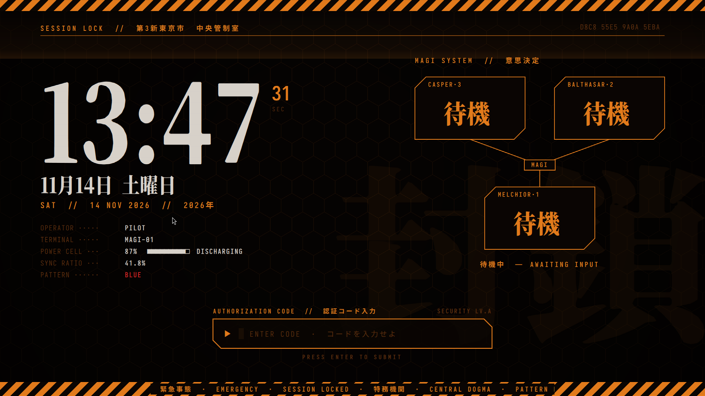
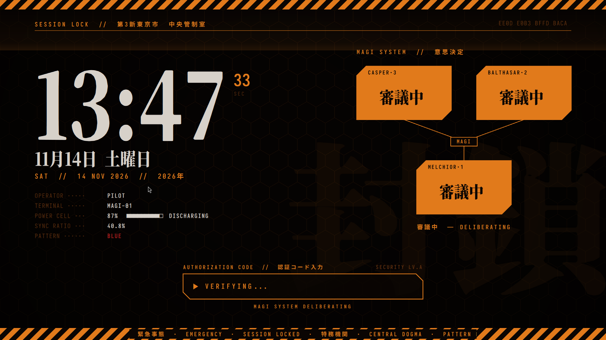
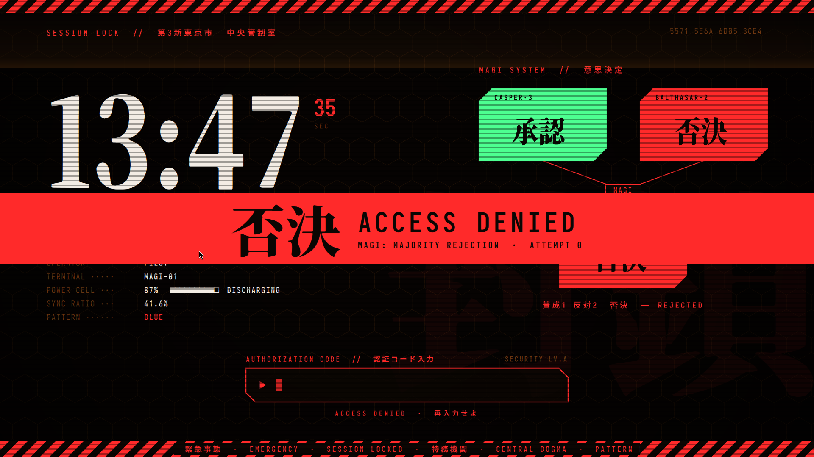
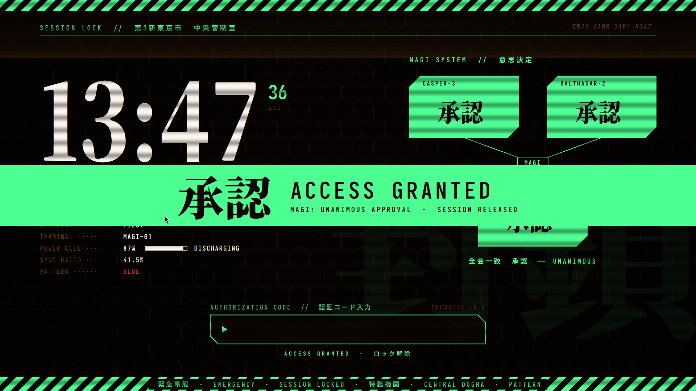

<div align="center">

# nerv-lock

**An Evangelion-inspired lock screen for Hyprland, built with Quickshell.**
Your password goes to the MAGI. The MAGI deliberate. The MAGI decide.



</div>

## Features

- **MAGI voting:** on Enter, CASPER·3, BALTHASAR·2 and MELCHIOR·1 flicker through `審議中` (deliberating) and reveal their verdicts one by one.
- **Approved:** all three turn green (`承認`), an `ACCESS GRANTED` band slams in, and the screen fades out.
- **Denied:** two units reject (`否決`), the screen flashes red and shakes, the whole UI turns red, and a failed-attempt counter appears.
- **Status panel:** a big condensed serif clock, the Japanese date, and live operator, terminal and battery readouts, plus a fluctuating sync ratio and a blinking `PATTERN BLUE` alert.
- **Ambient effects:** animated hazard stripes with a scrolling marquee, a hex grid, scanlines, a sweep line, and a boot-in curtain.
- **Authentication:** real PAM authentication through Quickshell's `PamContext`, using the `hyprlock` PAM config.
- **Safe fallback:** if Quickshell fails, the launcher falls back to `hyprlock`, so you never get stuck on a dead lock.

| Deliberating | Denied | Approved |
|---|---|---|
|  |  |  |

## Requirements

- Hyprland (any compositor with `ext-session-lock-v1` should work)
- [Quickshell](https://quickshell.org) 0.3+
- `hyprlock`, which provides `/etc/pam.d/hyprlock` and is used as the fallback
- Fonts: **Noto Serif CJK JP** (`noto-fonts-cjk`) and **Iosevka Nerd Font Mono** (`ttf-iosevka-nerd`)

On Arch:

```sh
sudo pacman -S quickshell hyprlock noto-fonts-cjk ttf-iosevka-nerd
```

## Install

```sh
git clone https://github.com/chenjiahao040-ctrl/nerv-lock.git
cd nerv-lock
./install.sh
```

This copies the QML files to `~/.local/share/nerv-lock` and the launcher to `~/.local/bin/nerv-lock`.

### Preview without locking

```sh
NERV_TEST=1 qs -p ~/.local/share/nerv-lock          # windowed, password "eva01", Esc quits
NERV_TEST=1 NERV_DEMO=denied qs -p ~/.local/share/nerv-lock   # idle | deliberating | denied | approved
```

### Keybind

`hyprland.conf`:

```ini
bind = SUPER, L, exec, ~/.local/bin/nerv-lock
```

Lua config (Hyprland 0.56+):

```lua
hl.bind("SUPER + L", hl.dsp.exec_cmd(os.getenv("HOME") .. "/.local/bin/nerv-lock"))
```

Idle locking with `hypridle.conf`:

```ini
general {
    lock_cmd = ~/.local/bin/nerv-lock
}
```

## If something goes wrong

If the lock ever crashes and Hyprland shows its red "lockscreen died" screen:

1. Switch to a TTY with `Ctrl + Alt + F3` and log in.
2. Run `hyprctl --instance 0 dispatch exec hyprlock`.
3. Go back with `Ctrl + Alt + F1` (or F2) and unlock with hyprlock.

Logs are written to `$XDG_RUNTIME_DIR/nerv-lock.log`.

## Customize

The colours are at the top of `LockUi.qml` (`orange`, `red`, `green`, `white`), along with the fonts (`serif`, `mono`). All sizes are relative to a 1920×1080 layout and scale to any resolution.

## Uninstall

```sh
./install.sh --uninstall
```

---

### Español

Pantalla de bloqueo para Hyprland inspirada en Evangelion, hecha con Quickshell. Al introducir la contraseña, los tres MAGI deliberan y votan: si se aprueba, se desbloquea, y si se rechaza, todo se vuelve rojo y la pantalla tiembla. Para instalarla, ejecuta `./install.sh` y asigna `~/.local/bin/nerv-lock` a tu atajo de bloqueo.

---

<sub>Fan project. Not affiliated with or endorsed by khara, Inc. or the Evangelion franchise. No official artwork, logos or fonts are included; all names are used for reference only.</sub>
